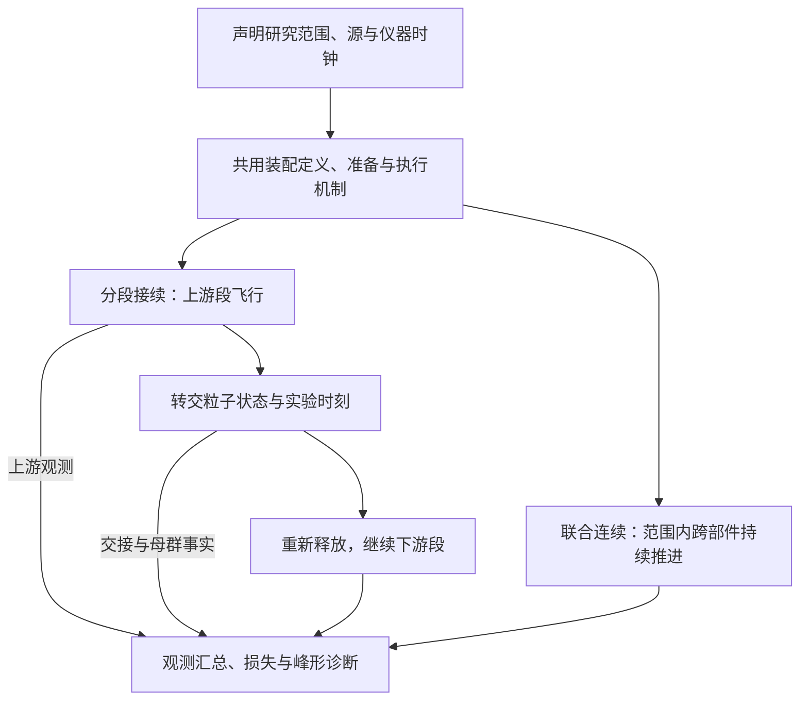

# 跨项目装配与物理工作流

本目录是跨项目装配的固定入口：器件与仪器项目拥有真实设计、组件、电极和端口，装配引用这些权威。
当前能力、证据与未完成验收只查[集成状态](docs/INTEGRATION.md)；目标与职责见
[连接标准](../docs/COMPONENT_CONNECTION_ARCHITECTURE.md)、[迁移计划](../docs/ROADMAP.md#统一组装迁移计划)。

按任务进入：[装配与公共机制](docs/INTEGRATION.md#装配与公共机制)、
[单反射整机](docs/INTEGRATION.md#单反射整机)、[共同场／有限脉冲](docs/INTEGRATION.md#共同场与有限脉冲)、
[门禁与剩余动作](docs/INTEGRATION.md#依赖冻结与门禁)。组件自身资格继续归各项目PROJECT。

`verify_integration.ps1`默认执行完整Ruff与测试发现；Repository范围沿公共catalog分为四组，按实际需要完成一次preflight，
各组在独立GATE预算内执行明确模块并即时报告失败与耗时。分组PASS不单独代表完整集成门禁通过。

## 配方解析

作者显式引用冻结完整父配方；默认执行其全部实例，局部范围必须从该父装配声明派生。
参数职责与源／时钟语义见[统一装配标准](../docs/COMPONENT_CONNECTION_ARCHITECTURE.md#完整装配粒子源与局部求解范围)，
波形与同步职责见[驱动标准](../docs/COMPONENT_CONNECTION_ARCHITECTURE.md#电压波形器件驱动与同步)。

配方格式为[assembly_recipe.schema.json](../common/contracts/schemas/assembly_recipe.schema.json)，
提供者接口为[component_geometry_interface.schema.json](../common/contracts/schemas/component_geometry_interface.schema.json)。
实例直接声明局部到唯一装配frame的刚体位姿；连接只校验真实端面、法向与间隙，不沿连接反算位姿或补偿偏移。

从仓库根使用公共入口，先替换占位路径：

```powershell
.\.venv\Scripts\python.exe -m common.integration.resolve_connection `
  --recipe "<recipe.json>" --components "<resolved-components.json>" `
  --plan-output "<run-inputs>/composition_plan.json"
.\.venv\Scripts\python.exe -m common.integration.resolve_connection `
  --verify-plan "<run-inputs>/composition_plan.json"
```

输出composition plan v3；可选`--local-scope "<local-scope.json>"`显式派生范围。
`stage=layout_only`不代表任何求解器都能执行该装配；实际支持集、资格和拒绝边界见集成状态。

## 活动工作流

以下为公开入口。商业执行须有明确科学输入、授权及相称预算；准备成功不代表求场、Fly或物理验收。
跨项目新run归`instrument_assembly`，独立组件几何／场／CAD仍归其提供者项目。

单反射、local和无碰撞cooled的科学request可写`"verify_saved_workbench_replay": true`，
显式请求保存工作台默认Fly回放；省略或false时记`not_requested`，正常Fly不再默认执行第二轮全母群。
单反射只有请求回放时才要求`instrument_default_replay`预算。保存／源绑定／回调实现或交付承诺改变时，
仍按相关变更执行相称原生验证；随机碰撞保留`saved_controls_only`，不能冒称默认Fly已通过。

### 模拟路径选择

下图是双路径的目标语义视图；箭头表示本次研究范围内的推进与数据交接。
它不声明全程场耦合或原生checkpoint能力，当前可执行范围见紧随其后的选择表。



图中的汇总要求保留各段、交接与原母群事实，不能只统计最后一段幸存者；未知状态不计为物理损失。

以下[分段命令](#分段接续模拟)与[连续命令](#联合连续模拟)给出实际入口和输入来源；
坐标、时钟与交接合同见[连接架构](../docs/COMPONENT_CONNECTION_ARCHITECTURE.md)，证据边界见
[集成状态](docs/INTEGRATION.md)。

| 路径 | 粒子与时钟 | 正常入口与当前范围 |
|---|---|---|
| 分段接续模拟 `segmented_handoff` | 声明研究范围包含状态导出与重新释放，原ID、母群与绝对时钟保持 | `accelerator_interface/execute.ps1 -FullJoint` 的MP/IP全链接续分支；单反射选择包括pre-pulse历史的范围时同样含接续 |
| 联合连续模拟 `continuous_assembly` | 声明传播范围内同一轨迹连续推进；中间观测不重新释放 | `single_reflection_flight/run.ps1` 或 `oa_mr/execute.ps1` 的实际连续范围；FullJoint直接prepared workbench分支仅覆盖其下游范围 |

分类依据本次声明的研究起止，不按脚本名或source_kind单独判断。单反射的`propagation_scope`
默认`declared_source_to_terminal`，pre-pulse快照之后可以连续；选`original_birth_to_terminal`时，
pre-pulse历史包含接续。结果同时记录体积状态重启时刻与实际连续起点，不伪造重启平面。

路径名称表达轨迹方式；场耦合仍由配方已有的`state_handoff`、`field_overlap`、
`monolithic_joint_solve`及实际场receipt表达。一次Fly、多个PA或名称中的joint均不能证明接口场正确。
`-FullJoint`保留在原owner，按分支说明范围；不把它整体改为单一路径标签。

### 分段接续模拟

以下完整例子从已封存IP源接续到MR，复用相匹配的设计、联合场与完整Fly前驱；不会重新创建上游母群。
从仓库根运行，所需外部产物须已在同级`artifacts`中；缺失时报告对应来源，不搜索latest：

```powershell
$artifacts = Join-Path (Split-Path -Parent (Get-Location).Path) 'artifacts'
$assembly = Join-Path $artifacts 'projects/instrument_assembly'
$mr = Join-Path $artifacts 'projects/parallel_mirror_dual_stripe_mr_tof'
$ip = Join-Path $artifacts 'projects/dual_pressure_rectilinear_ion_processor'
& integrations/workflows/accelerator_interface/execute.ps1 -FullJoint `
  -IonProcessorRunPath (Join-Path $ip 'runs/20261023_095324__sim__simion__multipole-524da-injected-ip-n100') `
  -ReferenceMrRunPath (Join-Path $mr 'runs/20261015_040845__sim__simion__converging-y360-z002-gaussian-ey-sigma0p15-n100') `
  -PreparedInterfaceRunPath (Join-Path $assembly 'runs/20261025_090904__analysis__python__accelerator-interface-ip-f3a137ee') `
  -JointFieldRunPath (Join-Path $mr 'runs/20261017_172646__sim__simion__ip-original-target340-stages-stage-055-field') `
  -ContractPath (Join-Path $assembly 'scratch/20261029__joint-v2-analysis-contract.json') `
  -ContinuationPredecessorManifestPath (Join-Path $assembly 'runs/20261029_225500__sim__simion__ip-mr-reuse-01fc842a/run_manifest.json')
```

该例子从实录IP出口状态在下游联合workbench重新释放；原母群100、转交81、未转交19，
不是MP起点的连续Fly。入口自动校验设计/源/场、执行必要的IOB绑定及接口审计、复用完整Fly批、分析并发布新run。
该分支并非全链零原生：已有Fly不重飞，绑定/审计仍按实际必要性执行；不对完整流程许诺零IOB。
准备新设计、源或场的输入组合见[当前入口说明](docs/INTEGRATION.md#oaip接口准备与绑定)。
`success`表示声明执行和数据合同完成；科学负结果与`candidate_only`不授予整机资格。
收尾中断时使用同一入口的`-FullJoint -ResumeFinalization -RunId <原flight_run_id>`。

### 联合连续模拟

从冻结配方和完整源调用下表中的连续入口；工作流自动建立所需场、workbench、批次、飞行与分析。
实际连续范围、源起点及场适用域以该次plan和receipt为准；下游独立PA与前端共同场须分别核对接口。
代表性正常运行例及其数值验收记录见[单反射整机](docs/INTEGRATION.md#单反射整机)。

若只研究已准备IP→MR下游范围，可直接消费上例已发布的workbench；例如以下命令只复用该范围的完整飞行结果并重分析，
不表示本轮从原出生点完成了新Fly。该分支不选择IP/OA设计provider：

```powershell
$artifacts = Join-Path (Split-Path -Parent (Get-Location).Path) 'artifacts'
$assembly = Join-Path $artifacts 'projects/instrument_assembly'
& integrations/workflows/accelerator_interface/execute.ps1 -FullJoint `
  -PreparedJointWorkbenchRunPath (Join-Path $assembly 'runs/20261025_115429__analysis__python__accelerator-interface-ip-81ed4b78') `
  -ContractPath (Join-Path $assembly 'scratch/20261029__joint-v2-analysis-contract.json') `
  -ContinuationPredecessorManifestPath (Join-Path $assembly 'runs/20261029_225500__sim__simion__ip-mr-reuse-01fc842a/run_manifest.json')
```

以下例子使用当前裸八极杆、三区OA和单反射分析器配方，实录100粒子出生源从多极杆入口开始。
请求与预算由同级产物目录显式提供；源码checkout本身不包含这些外部科学输入：

```powershell
$artifacts = Join-Path (Split-Path -Parent (Get-Location).Path) 'artifacts'
$case = Join-Path $artifacts 'projects/instrument_assembly/scratch/20261030__continuous-assembly-case'
& integrations/workflows/single_reflection_flight/run.ps1 `
  -Request (Join-Path $case 'request_functional.json') `
  -ExecutionBudgetPath (Join-Path $case 'execution_budget.json')
```

该请求预先引用`functional_validation.json`，冻结N100功能问题、事件顺序、母群与时钟容差及三态判据，
并显式引用093627运行已完成发布的前端与下游场；该父run后续IOB审计失败，不改变已完成场的独立来源事实。
入口自动冻结提供者与母群、准备或复用三工作点共同MP／OA场及下游场、装配、飞行与分析；保存工作台回放仅按显式请求执行，
按内容身份复用仍有效的场。新run位于`artifacts/projects/instrument_assembly/runs/`，
summary指向实际composition／scope和source provenance；canonical事件及母群结果在
`results/single_reflection/baseline/collection.json`。粗网格为2×2×0.1 mm，理想透明栅屏蔽分域，
原始ID和绝对时钟从出生到终态保持；没有中途导出重放。
运行完成与数据闭合不表示有限栅边缘场、峰形／分辨率或Formal资格通过，零检测仍保留科学负结果。

| 科学工作流 | 公开入口与显式输入 | 状态及操作边界 |
|---|---|---|
| 裸导引→二区／三区OA | [local_frontend/execute.ps1](workflows/local_frontend/execute.ps1)，`-Request` | [准备与复核](docs/INTEGRATION.md#局部前端执行与复核) |
| 冷却前端→OA | [cooled_frontend/execute.ps1](workflows/cooled_frontend/execute.ps1)，`-Request` | [局部证据](docs/INTEGRATION.md#局部前端执行与复核) |
| 多极杆→OA→单反射TOF | [single_reflection_flight/run.ps1](workflows/single_reflection_flight/run.ps1)，`-Request -ExecutionBudgetPath` | [schema 9及默认完整Fly](docs/INTEGRATION.md#单反射整机)；内部execute由owner调用 |
| OA／IP→MR接口准备与执行 | [accelerator_interface/execute.ps1](workflows/accelerator_interface/execute.ps1)，准备时明确提供者与参考run；`-FullJoint`按源链或prepared workbench分支执行 | [输入及设计／Finalize边界](docs/INTEGRATION.md#oaip接口准备与绑定) |
| 已准备IP→MR飞行／分析 | [prepared_joint/execute.ps1](workflows/prepared_joint/execute.ps1)，准备run与观测合同 | [联合执行及Analysis](docs/INTEGRATION.md#已准备ipmr联合飞行) |
| OA→MR | [oa_mr/execute.ps1](workflows/oa_mr/execute.ps1)，`-CompositionPlanPath`及可选`-LocalScopePath` | [支持范围与证据](docs/INTEGRATION.md#已准备ipmr联合飞行) |
| 真实多极杆→IP状态准备 | [multipole_ip/execute.ps1](workflows/multipole_ip/execute.ps1)，`-Request` | [真实源／母群与负结果](docs/INTEGRATION.md#真实多极杆ip状态交接) |
| OA共同静态场 | [paired_accelerator_static_field/execute.ps1](workflows/paired_accelerator_static_field/execute.ps1)，`-Request` | [prepared／solved恢复及资格](docs/INTEGRATION.md#共同场与有限脉冲) |
| OA共同场有限脉冲 | [paired_accelerator_pulse/execute.ps1](workflows/paired_accelerator_pulse/execute.ps1)，`-Request`及显式来源 | [阶段／整批恢复与诊断](docs/INTEGRATION.md#共同场与有限脉冲) |

直属静态入口为[verify_integration.ps1](verify_integration.ps1)，不启动商业求解器。
入口递归枚举`integrations/tests`中的测试模块；Changed范围按统一目录传入`ChangedTestModules`时合并去重，
保持该入口的Ruff检查。测试使用公共计时runner，即时报出失败详情并逐测试计时；明确的纯测试模块变更
可由Changed范围精确运行，fixture、删除或未知目录变化扩大到owner。
软件验证、冻结依赖与最终验收见[状态页](docs/INTEGRATION.md#依赖冻结与门禁)及[操作指南](../docs/OPERATIONS.md#软件验证与科学证据)。
不使用已退役的旧family或arm CLI执行新实验；历史运行保持原身份。

## 当前文本绑定编译

唯一入口为`python -m integrations.runtime.refresh_repository_bindings [--check]`。
它刷新oaTOF required port的受管文本绑定，不改科学设计或历史证据；
运行依赖只由[runtime_dependencies.json](config/runtime_dependencies.json)声明，冻结机制见状态页。

## 历史追溯

[历史索引](docs/history/README.md)维护冻结阶段证据及旧工作流入口；当前操作和能力继续由本页与集成状态维护。
